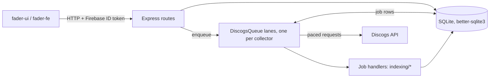
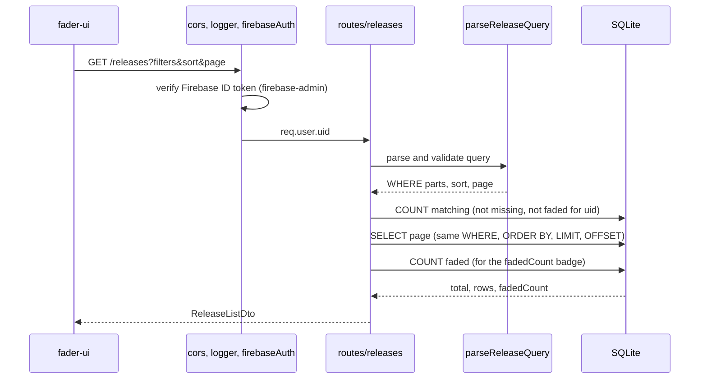
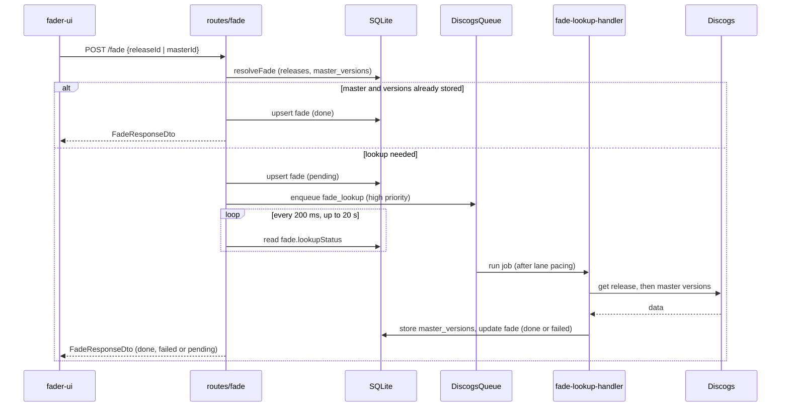
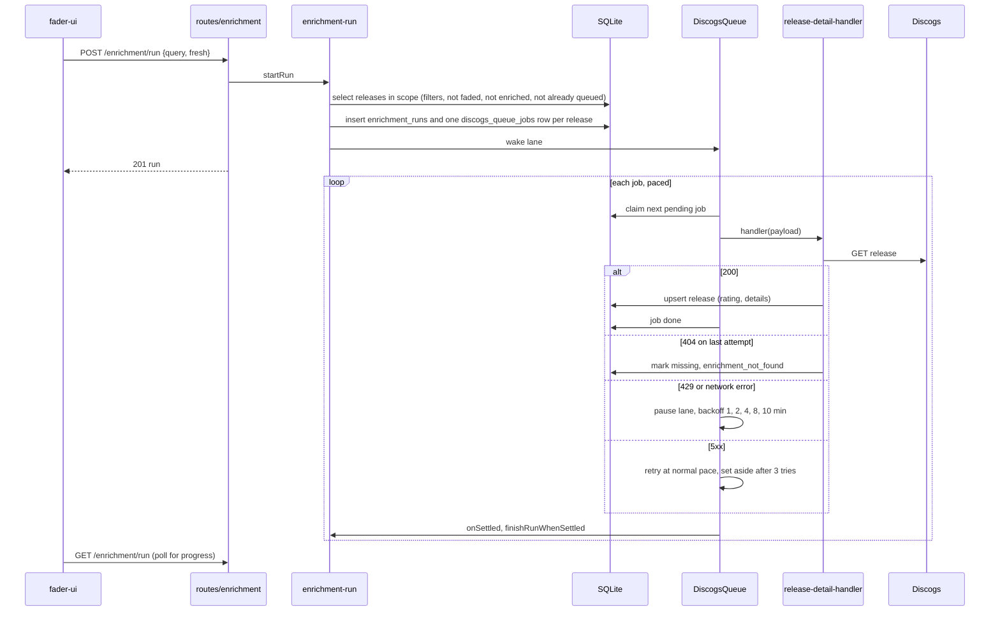

# Backend flows

Sequence diagrams of the operations that matter when judging a rewrite. Written from the code
(`src/routes/fade.ts`, `src/enrichment/enrichment-run.ts`, `src/queue/discogs-queue.ts`,
`src/indexing/*`); update them when those change. GitHub renders the Mermaid blocks.

Companion files: `schema.dbml` (tables, indexes; `npm run docs:db`), `modules.mmd` (module
graph; `npm run docs:deps`), and the system overview in the `fader-ui` repo
(`docs/architecture/overview.md`).

## Process shape

One Node process: Express (HTTP), a `DiscogsQueue` (in-memory lanes over a SQLite job table), and
`better-sqlite3` (synchronous, in-process). There is no separate worker, so a slow synchronous
query blocks HTTP and the queue alike.

## Browse releases (the hot read path)

`GET /releases` parses the filter query, builds a Drizzle `WHERE` and runs it against `releases`
and the side tables. This is the path where the schema's composite and expression indexes
(`schema.dbml`) decide the cost, not the language.

## Fade (user waits for a lookup)

`POST /fade` answers immediately when the master is already known. Otherwise it stores the fade
as `pending`, enqueues a lookup and **polls the fades table every 200 ms for up to 20 s**
(`awaitLookup`), answering `pending` if the lookup has not settled.

## Enrichment run (the long background job)

A run turns an Explore filter into one `release_detail` job per release, then drains them at the
lane's pacing. Run and job state live in SQLite, so a restart resumes them (`index.ts` calls
`finishRunsWithNothingLeft` and `queue.start`). Throughput is capped by Discogs pacing, not by CPU.

## What the diagrams suggest for a rewrite

These are hypotheses to check with measurements (see fader-ui issue for tracing), not findings.

- `GET /releases` runs three queries per request (total, page, faded count); the two counts are
  `COUNT`s over a filtered set, a candidate for caching or cheaper counting.
- Enrichment and fade lookups wait on Discogs pacing and the rate limit, so a faster language
  changes almost nothing there.
- The read path is bound by SQLite and its indexes. The SQL and the schema move with you; the
  language matters less than keeping the same indexes and query shapes.
- The import (`src/import`, XML dump) is the likeliest CPU-bound code; profile it first.
- The 200 ms polling in `awaitLookup` and the single process holding queue state in memory are
  design choices to revisit in a rewrite regardless of language.
- The OpenAPI file (`src/docs/openapi.yaml`, ADR 0003) is the contract a rewrite must keep.
